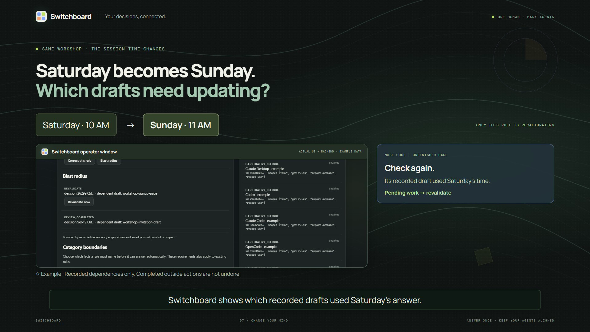
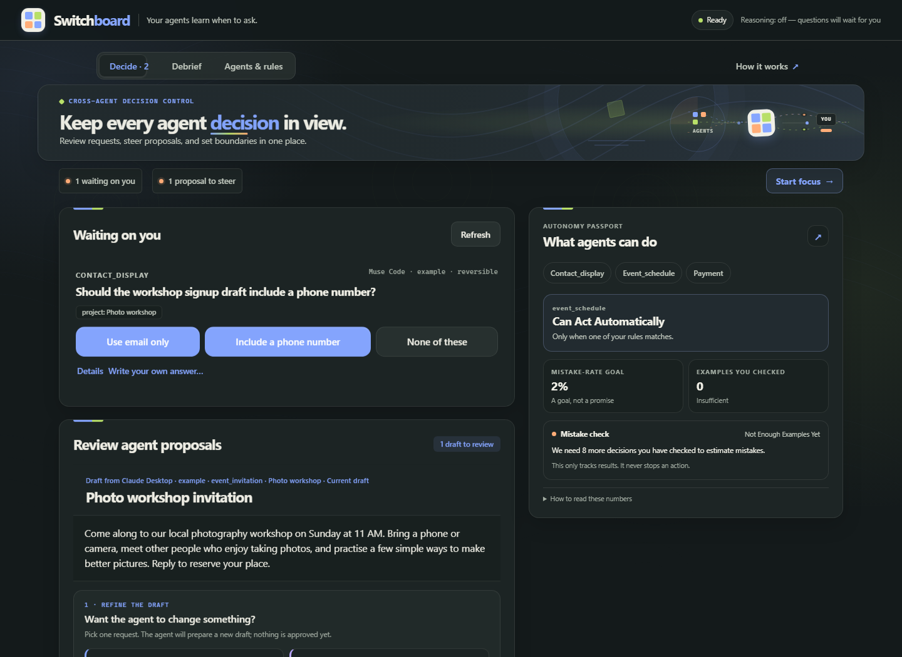
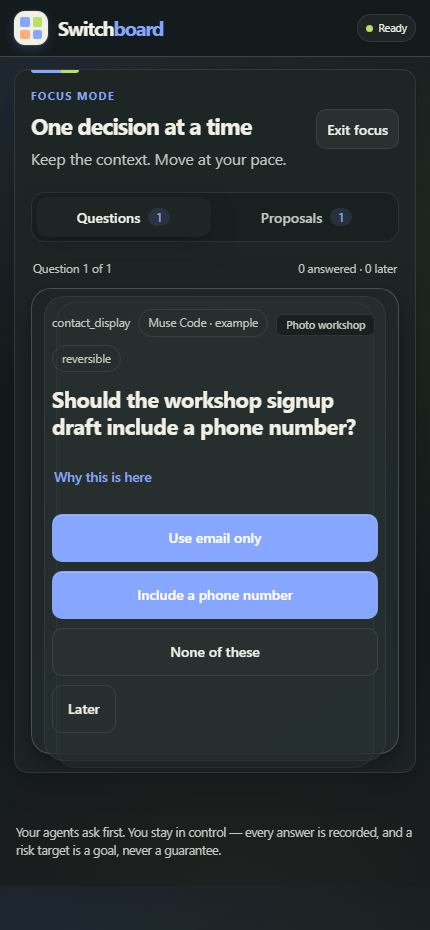
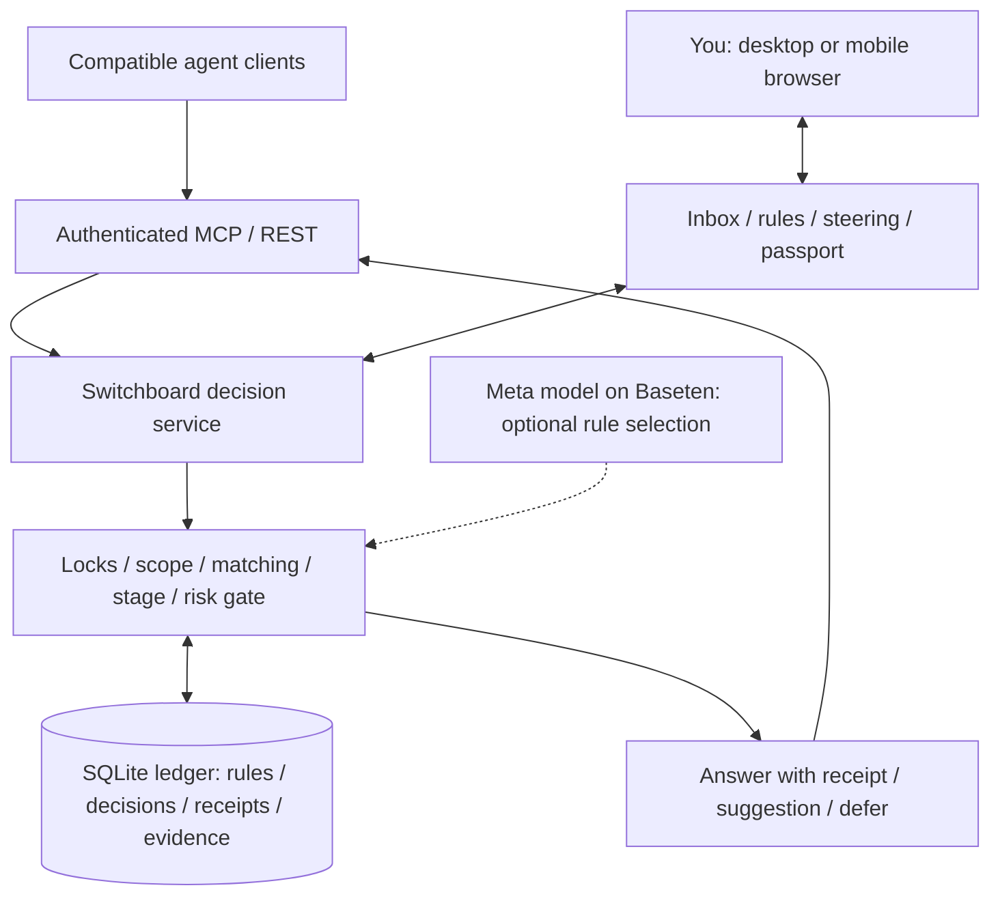

<p align="center">
  
</p>

<h1 align="center">Switchboard</h1>

<p align="center"><strong>Answer once. Keep your agents aligned.</strong></p>

<p align="center">A shared place for your AI assistants to check your decisions,<br />stay within your limits, and track what needs review when you change your mind.</p>

<p align="center">
  <a href="#watch-the-demo">Watch the demo</a> ·
  <a href="#supported-assistants">Supported assistants</a> ·
  <a href="#what-switchboard-does">Features</a> ·
  <a href="#run-locally">Run locally</a> ·
  <a href="#architecture">Architecture</a>
</p>

Your assistants can build, write and research in parallel. You still carry the decisions between them: repeating details, answering questions and remembering who needs an update.

**Switchboard is your autonomy layer across compatible agents.** Connected agents check for a saved answer before asking you. Answers are reused only where your configured rules allow it. Questions that still need your judgment arrive in one operator window.

## Watch the demo

[](https://github.com/KanishkNoir/SwitchBoard/releases/tag/hackathon-final-2026-11-04)

**2:59 · updated narrated walkthrough.** [Watch / download the video](https://github.com/KanishkNoir/SwitchBoard/releases/tag/hackathon-final-2026-11-04) · [1080p MP4](https://github.com/KanishkNoir/SwitchBoard/releases/download/hackathon-final-2026-11-04/Switchboard-Hackathon-Policy-Benchmark.mp4) · [Subtitles](https://github.com/KanishkNoir/SwitchBoard/releases/download/hackathon-final-2026-11-04/Switchboard-Hackathon-Policy-Benchmark.srt) · [Video verification](https://github.com/KanishkNoir/SwitchBoard/releases/download/hackathon-final-2026-11-04/verification-policy-benchmark.json)

See the current operator controls, correction impact, Focus, the synthetic benchmark tradeoff, and a verified Meta Muse Spark Open call through Baseten. The walkthrough uses the actual interface with labelled example data. Historical ChatGPT–phone proof is separate; the film does not claim a newly recorded native cross-agent correction run. [Demo and evidence notes](assets/readme/DEMO.md).

## Supported assistants

Keep the assistants you already use. Connect their decisions through Switchboard.

<table>
  <tr>
    <td align="center" width="25%"><br /><strong>Muse Code</strong><br /><sub>Meta coding agent</sub></td>
    <td align="center" width="25%"><br /><strong>Codex</strong><br /><sub>Desktop · CLI</sub></td>
    <td align="center" width="25%"><br /><strong>Claude Code</strong><br /><sub>CLI · extension</sub></td>
    <td align="center" width="25%"><br /><strong>OpenCode</strong><br /><sub>Coding agent</sub></td>
  </tr>
  <tr>
    <td align="center"><br /><strong>Hermes</strong><br /><sub>Agent harness</sub></td>
    <td align="center"><br /><strong>Claude Desktop</strong><br /><sub>Desktop assistant</sub></td>
    <td align="center"><br /><strong>ChatGPT</strong><br /><sub>Account · web · mobile</sub></td>
    <td align="center"><br /><strong>Claude</strong><br /><sub>Account · web · mobile</sub></td>
  </tr>
</table>

Authenticated connections have been checked across these eight client families. Setup, account availability and enforcement vary by client. Claude Code and OpenCode have verified project action gates; the other clients rely on their configured ask-first instructions. See the [connection and enforcement matrix](#agent-support-today) and [setup report](integrations/CLIENT_SUPPORT.md).

## What Switchboard does

| Feature | What it helps you do |
|---|---|
| **Saved answers with limits** | Reuse an answer for matching work in the right project, environment and context. |
| **One operator window** | See what needs you, manage connected agents and answers, and understand why a decision was used. |
| **Correction impact** | Find recorded work that relied on an old answer and see what needs another check or review. |
| **Focus on your phone** | Handle one contextual decision at a time with deliberate answer buttons and a proposal lane. “Later” keeps it pending. |
| **Steering and review** | Request a simpler or different draft, inspect its revision, and approve separately. |
| **Autonomy Passport** | Inspect the current category stage, evidence, holds and limits before deciding what may run on its own. |
| **Decision receipts** | Trace an answer to its rule version and recorded downstream uses. Agent-reported success stays separate from human confirmation. |

Compatible unresolved questions can share an inbox answer only when their intent, options, context, risk and consequences are compatible. A one-time Focus answer does not silently become a standing rule.

## At your desk. On your phone.

<table>
  <tr><th>Operator window</th><th>Focus mode</th></tr>
  <tr>
    <td width="72%"></td>
    <td align="center"></td>
  </tr>
</table>

*Actual interface, isolated example data. Focus is the mobile-friendly view of the same decision inbox.*

## Why this problem matters

- **Supervision takes attention.** In BCG's study of 1,488 full-time US workers, 14% of the AI-user subgroup reported fatigue from excessive AI use or oversight. This is self-reported context for the problem, not a clinical diagnosis or a Switchboard result. [BCG, 2026](https://www.bcg.com/publications/2026/ai-for-ceos).
- **Oversight spans the whole workflow.** Exploratory interviews with 17 developers described controls, planning, monitoring and later review. That motivates an operator experience covering decisions, steering and corrections. The small qualitative study did not evaluate Switchboard. [Dhanorkar, Passi and Vorvoreanu, 2026 preprint](https://arxiv.org/abs/2606.05391).

Switchboard aims to reduce repeated interruptions and stale assumptions while preserving human control. Time saved, fatigue reduction and willingness to pay still need real-user validation.

Built for the **Meta × Cerebral Valley hackathon**. **Meta models via Baseten** provide optional eligible-rule matching; **Modal** hosts the shared hub and supports other model access. Your confirmed rules remain the authority.

## How a decision earns an answer

Switchboard checks hard locks and mandatory scope before matching an existing rule. It then applies the category's stage, recalibration holds, and configured risk gate.

- **`shadow`** records what the system would have answered and queues the question.
- **`suggest`** proposes an answer for human review.
- **`warn`** returns an answer with a notice the user can review or veto.
- **`auto`** returns an eligible answer without another interruption.

New categories start in `shadow`. Stages are configured; the system does not silently promote itself. The evidence-based risk gate defaults to observation mode (`SWITCHBOARD_RISK_GATE_MODE=shadow`); `enforce` makes insufficient evidence a reason to defer. Hard locks and mandatory scope checks apply independently of that setting.

Under **Agents & rules**, operators can require category boundaries such as project and workspace, repair existing incomplete rules, and preview corrections before applying them. Conflicting exact rules defer; strictly more specific exact rules can override broader defaults. Unchanged updates keep calibration, while wider scopes require stronger confirmation. [Policy behavior and operator controls](integrations/POLICY_LOGIC.md) explain the defaults, deliberate rule review and limits. Categories without configured boundary requirements retain legacy behavior.

Payments, deletions, messages to new recipients, and actions classified as irreversible are locked for automatic answering. A model, a learned preference, or an Away-mode grant cannot remove those locks.

When Switchboard defers, the agent leaves the question in its inbox and continues independent work. It must not guess, repeat the question directly to the user, or treat a queued request as permission.

## Architecture

MCP and REST enter the same decision service. The web interface is where you answer, correct, steer, and inspect the results.



**The application owns authorization.** Exact rules and local similarity matching work without model calls. Optional Meta reasoning can select an existing eligible rule; it cannot invent an active rule, lower risk, or authorize an action. Model confidence is not treated as a calibrated probability.

Each decision retains a versioned policy trace. Dependency records connect receipts to downstream work. Human confirmations and corrections can contribute to calibration; agent claims, model inferences, tool events, and synthetic traces do not count as human preference labels.

The backend is Python/FastAPI, the interface is React/TypeScript, and MCP connects the clients. A local installation keeps its ledger on the machine. Hub mode sends authenticated agent requests to one shared deployment. The current Modal hub uses a persistent volume and a single SQLite writer.

### Where Meta, Baseten, and Modal fit

| Component | Role |
|---|---|
| **Meta model through Baseten** | Optional reasoning and semantic rule selection, using the configured Muse Spark Open model endpoint. |
| **Modal** | Hosts the Switchboard hub, persistent ledger, and configured model endpoints. The backend also supports Modal reasoning adapters. |
| **SAM 3.1 / Muse Image** | Optional image grounding and concept previews through configured provider endpoints. |

Visual Scout can ground a question in an object selected from an image. Concept previews let you explore a proposal's direction. Generated concepts are labelled; unknown prices or facts remain unknown. **Steering changes a draft. It does not buy, send, or delete.**

## Agent support today

The 4 November 2026 integration pass tested actual MCP calls and authenticated identities, including launches from an unrelated working directory. The logo overview above identifies supported client families; this matrix distinguishes connection evidence from enforcement.

| Client | Verified connection | Automatic Switchboard action gate |
|---|---|---|
| Codex desktop / CLI | Global and project configuration; authenticated MCP calls | Ask-first instructions; no pre-tool gate verified |
| Claude Code / extension | Native CLI connection and authenticated MCP calls | Project hook, including failure blocking |
| OpenCode | Native CLI connection and authenticated MCP calls | Project plugin; broken credentials keep actions blocked |
| Muse Code | Authenticated calls from the saved user configuration | Ask-first instructions |
| Claude Desktop | Authenticated calls from both Windows configuration locations | Ask-first instructions |
| Hermes | Native Windows installation, native MCP discovery, authenticated calls | Ask-first instructions |
| ChatGPT account / web / mobile | Account connector linked; live calls and phone Focus round trip verified; native app check confirmed by the user | Ask-first instructions |
| Claude account / web / mobile | Account connector linked; live calls verified; native app check confirmed by the user | Ask-first instructions |

MCP gives an agent access to Switchboard. Enforcing every tool call requires a harness-specific gate. The installed Claude Code and OpenCode gates apply in this project; other clients must follow their instructions. Existing sessions need an MCP reload or restart after configuration changes.

See the [client support report](integrations/CLIENT_SUPPORT.md), [Claude Code gate](integrations/CLAUDE_CODE_ACTION_GATE.md), [OpenCode gate](integrations/OPENCODE_ACTION_GATE.md), and [mobile connectors and Focus mode](integrations/MOBILE.md).

## Run locally

Requires Python 3.12+, [uv](https://docs.astral.sh/uv/), and Node.js/npm for the React interface.

```powershell
uv sync
npm --prefix frontend ci
npm --prefix frontend run build
uv run python -m switchboard.app
```

Open **http://127.0.0.1:8765**. A fresh checkout runs without model credentials. Optional features and provider settings are documented in [.env.example](.env.example).

To use Meta reasoning through Baseten, keep `BASETEN_API_KEY` in your private `.env`, select `SWITCHBOARD_REASONING_PROVIDER=baseten`, and enable `SWITCHBOARD_ENABLE_T3=true`. The example configuration also supports Modal and Meta API adapters. Model calls are opt-in; an unavailable provider cannot supply an automatic answer.

For frontend development, run `npm --prefix frontend run dev` alongside the backend. Vite serves port **5173** and proxies API requests to **8765**.

### Connect a client

Register a dedicated agent in **Agents & rules**. Save its one-time key in a private file, then generate the client's configuration:

```powershell
uv run python -m switchboard.onboard --agent codex --api-key-file C:/private/codex.key
```

Merge the generated entry into the client's existing settings. Other supported names include `claude-code`, `opencode`, `muse`, `claude-desktop`, and `hermes`. Add `--remote https://your-hub.example` to share a hosted ledger. Generated files go to ignored `integrations/generated/`; never commit real credentials.

Start verification with **`get_connection_status`** and check the expected agent identity, then call **`get_rules`**. Discovering tools alone does not establish a working connection. Failed hub lookups return an explicit error rather than an apparently empty rule set.

The nine MCP tools cover three workflows:

| Workflow | Tools |
|---|---|
| Decide | `ask`, `get_rules`, `get_action_request_status` |
| Verify and account for use | `get_connection_status`, `record_use`, `report_outcome` |
| Steer a proposal | `submit_proposal`, `get_steering`, `revise_proposal` |

Agents should ask with a stable request ID, honor the returned scope, record receipt use before dependent work, and report outcomes as agent assertions. Agent identity comes from credentials, never a name supplied in a request. See [AGENTS.md](AGENTS.md) for the protocol and [the external harness](harness/external_harness.py) for an MCP example.

### Use it from your phone

The **Switchboard web interface** works on mobile screens. For a local instance, the [tunnel script](scripts/start-tunnel.ps1) creates an authenticated login link:

```powershell
powershell -ExecutionPolicy Bypass -File scripts/start-tunnel.ps1
```

Treat that link like a password; it grants operator access and sets a 30-day cookie. A token-protected hosted hub also serves the interface directly.

**Focus mode** presents one decision at a time with large answer buttons, context on demand, and a separate proposal lane. Tap **Start focus** when work is waiting. Eligible simple questions support swipes; locked requests and action reviews require deliberate taps. **Later** keeps the question in the inbox, and a steering swipe requests a revision.

Claude and ChatGPT account connectors are linked and verified through live browser calls. A ChatGPT request was answered from Focus mode on a phone, and the agent retrieved and used that answer. The user also confirmed completing native Claude and ChatGPT phone-app checks. See [mobile setup and the verification flow](integrations/MOBILE.md).

### Deploy on Modal

Configure the existing Modal profile, `switchboard-secrets`, and the public HTTPS origin for OAuth. Build the frontend and back up the persistent ledger before deployment:

```powershell
$env:SWITCHBOARD_MCP_PUBLIC_URL = "https://your-modal-function-host"
$env:SWITCHBOARD_BUILD_ID = "your-git-commit"
modal deploy --strategy recreate modal_app.py
```

The hosted MCP endpoint is `<public-origin>/mcp`. OAuth and operator routes have separate authentication. Keep one container while using the SQLite volume; `recreate` avoids overlapping writers and delayed rolling replacements. See [modal_app.py](modal_app.py) and the [deployment notes](integrations/CLIENT_SUPPORT.md#enforcement-and-deployment).

## Evidence and limits

The current policy pass verified **236 backend tests**, the frontend production build, subprocess MCP-over-HTTP, OpenCode gate checks, and synthetic browser flows at desktop and phone widths. Earlier integration checks cover authenticated client calls and mobile OAuth flows. These establish tested behavior, not universal compliance by every agent or a connection to every user's phone.

The [versioned synthetic benchmark](benchmarks/README.md) tests **40 episodes and 220 questions per strategy** across five domains and eight conditions: reuse, scope, intent, corrections, downstream impact, hard locks, evidence integrity and deliberate failure cases. Every strategy receives the same simulated user answer when it requests review.

| Strategy | Correct automatic reuse / 160 eligible questions | Wrong automatic decisions / 220 questions | User reviews / 220 questions |
|---|---:|---:|---:|
| Always ask | 0 | 0 | 220 |
| Apply corrections and immediately resume | 135 | 30 | 55 |
| Switchboard with recalibration holds | 100 | 15 | 105 |

In these fixtures, holds catch noisy corrections at the cost of more review. **All 15 remaining errors** come from incomplete authored scope or preference changes never communicated to Switchboard. A correct value returned across a required-review boundary counts as an error too.

Correction-impact checks find **15/15 affected recorded work IDs with zero false alarms**; actually omitting dependency recording finds **0/15**. Unknown coverage earns no detection credit. [Current results by condition and ablations](benchmarks/RESULTS.policy-v2.md), [raw traces](benchmarks/results.policy-v2.json), [frozen dataset](benchmarks/scenarios.v1.json) and [reproduction instructions](benchmarks/README.md#reproduce) are public. The original [v1 report](benchmarks/RESULTS.v1.md) is preserved. The current policy asks five more times because task IDs no longer count as fresh contexts; the dataset does not exercise configured category contracts.

These are correlated synthetic service tests with local matching and the risk gate in shadow mode. They do not measure native assistant compliance, real-user time savings or a production error rate. Adaptive policy proposals, automatic promotion and AI rewriting of active autonomy policies remain future work.

### Verification

```powershell
uv run pytest -q
node tests/test_opencode_gate.mjs
```

Set `SWITCHBOARD_IT=1` to include the real subprocess MCP-over-HTTP test. Backend coverage includes policy, scope, corrections, evidence integrity, migrations, cache behavior, authentication, OAuth, and portable client configuration.
