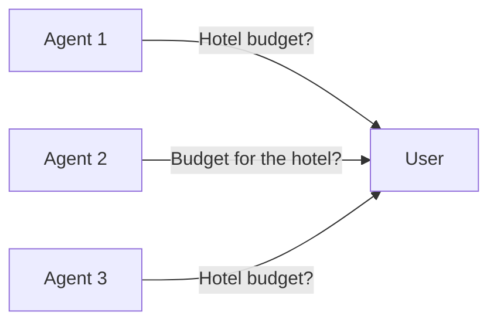
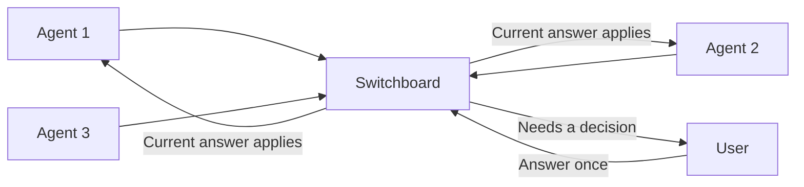
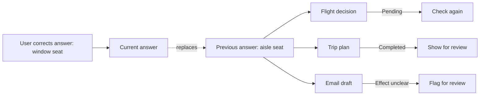
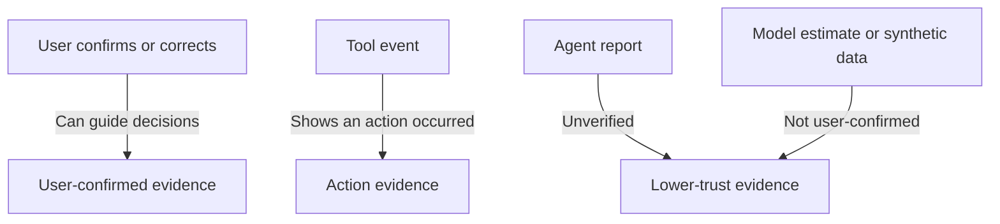
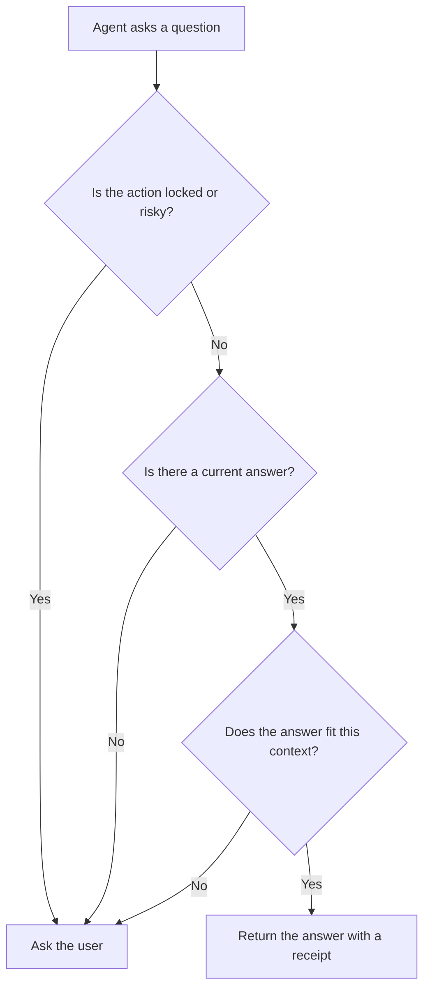
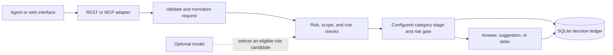
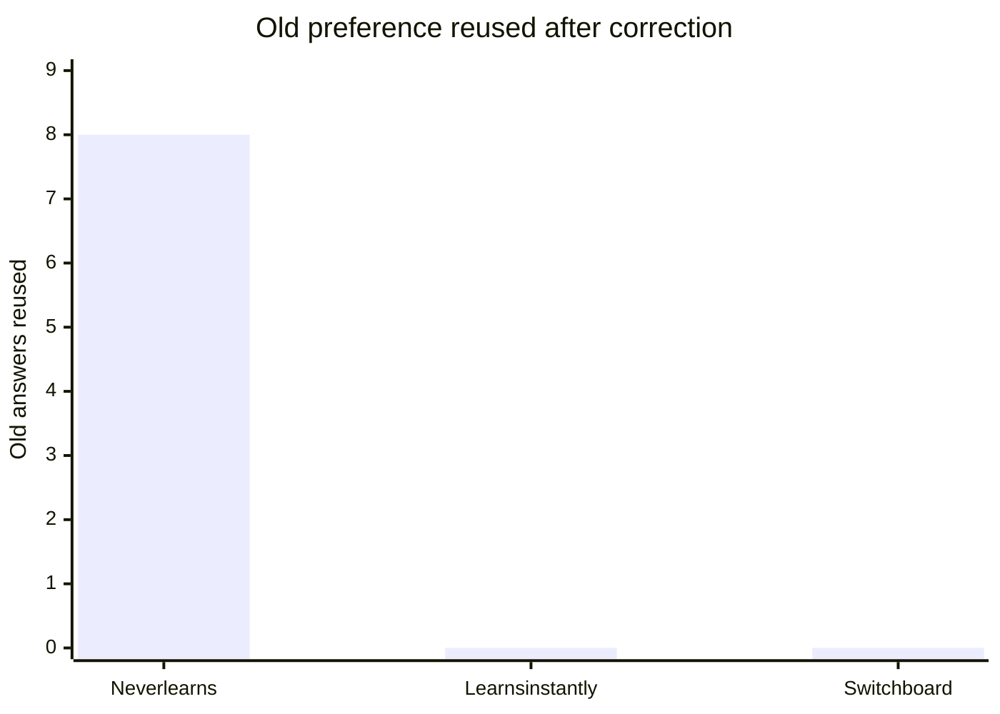

# Switchboard

### A shared decision service for AI agents.

AI agents often ask the same person the same questions. They may repeat a question in different words, or reuse an old answer in a new context.

Switchboard gives compatible agents one place to check for current answers and ask questions they cannot safely resolve. It applies answers only within their defined scope, records how decisions were made, and sends unresolved questions to a shared inbox.

## The problem

Without a shared decision service, each agent asks the user separately:



With Switchboard, agents check the same decision service:



The user answers once when an existing answer does not apply. Switchboard then gives the result to agents that ask the same question within the same scope.

## What Switchboard does

### Reuses answers within their scope

An agent can ask Switchboard before it asks the user. If a current answer applies to that agent and context, Switchboard returns it with a receipt. If there is no suitable answer, the question enters a priority queue. Equivalent questions can be grouped so the user can answer once for the waiting agents.

### Tracks the effect of corrections

When a user changes a preference, Switchboard finds decisions that depended on the previous answer. It marks affected pending work for review and shows the user which decisions may need attention. Completed work is shown for review when its status cannot be determined.



### Checks context boundaries

An answer for staging should not apply to production just because the question uses similar words. Switchboard checks scope before it uses similarity to match an answer.

### Separates user evidence from agent claims

An agent report that an action worked is not the same as a user confirming the result. Agent reports, model estimates, and synthetic test data are stored as lower-trust evidence. They do not count as user-confirmed evidence.



### Shows the current autonomy level

The Autonomy Passport shows each category's current stage: `shadow` (log the result), `suggest` (ask the user), `warn` (return an answer with a notice), or `auto` (return an answer without asking). It also shows the evidence and limits behind that stage. After a correction, the affected part of a category returns to probation before it can regain trust.

## How a question is handled



Switchboard checks risk, existing answers, and scope before returning an answer. If it cannot resolve a question safely, it defers to the user.

Locked actions include payments, deletions, messages to new recipients, and other irreversible actions. In version 1, these actions always require a user decision. Rules and learned preferences cannot override that requirement. Away mode cannot bypass it.

## Architecture and feature boundaries

The web API and MCP server use the same request pipeline. They do not maintain separate rule or permission engines.



The model can help select an existing eligible rule when optional semantic matching is enabled. The application checks risk, scope, authorization, and the category stage. A model cannot create or activate a rule, lower a risk classification, or authorize an action.

The features have separate roles:

- **MCP and REST** connect agents and the web interface to the same decision service.
- **Harness-specific action gates** can check a tool call before an agent executes it. MCP support alone does not intercept every tool call.
- **Steering** changes a proposal draft. It does not approve or execute the proposal. Approval is a separate user action.
- **The Autonomy Passport** shows the category's current stage, evidence, and limits. It reports policy state; it is not a second permission system.
- **Hard locks** always require a user decision. The category risk gate is a separate check that can defer when evidence is insufficient or outside its target.

### What has changed in the backend

Each decision now stores a versioned, privacy-minimized policy trace. It records the policy versions, risk reasons, effective category stage, matcher tier, selected rule version, scope result, and decision reason. It stores a fingerprint of request context instead of copying raw context into the trace.

Request identity includes permission-relevant risk hints and option values. A request that changes one of these values is treated as a different request. An agent may mark a request as `locked`, which can raise the server's risk classification. An agent cannot use a hint to lower it. The supported hints are validated at the API, MCP, and remote interfaces.

Optional hosted models may select an existing rule candidate. They do not provide calibrated confidence scores. The system does not treat a model's self-reported confidence as a probability.

### Adaptive policy work is still in progress

The current code adds decision traces and safer request validation. It does not yet let AI change active autonomy policies. Category stages remain configured, and locks stay under deterministic application control. The planned policy registry, evidence-based proposals, shadow evaluation, and measured promotion are future work. A policy change will need validation and outcome evidence before it can affect live decisions.

## Visual features

- **Visual Scout** uses SAM 3.1 to segment objects in an image. The user can select an object, such as a lamp, and ask a question about it.
- **Muse Image** can generate or edit concept previews while the user steers a proposal. The four directions can represent cheaper, more comfortable, less obvious, or simpler options.
- Generated images are labelled as concepts. They are not presented as real product photos. Prices and other facts come from user-provided data or are marked unknown.

Gestures can change a proposal. They cannot approve a purchase, send a message, or delete data.

## Quickstart

```powershell
uv sync
uv run python -m switchboard.app
```

Open **http://127.0.0.1:8765** in your browser.

By default, the decision ledger is stored on your machine. Model calls are optional. If a model provider fails, Switchboard defers instead of guessing.

### Use the interface on your phone

The web interface supports mobile screens. To access it from a phone, run the tunnel script and open the login link it prints:

```powershell
powershell -ExecutionPolicy Bypass -File scripts/start-tunnel.ps1
```

The link signs the phone in and creates a 30-day cookie. Treat the link like a password. Anyone who has it can access the workspace as you. When `SWITCHBOARD_UI_TOKEN` is set, the interface requires login. The tunnel script sets this token.

## Connect agents with MCP

Register an agent in the **Agents & rules** tab. Put its key in the agent's environment, then start the Switchboard MCP server:

```powershell
$env:SWITCHBOARD_AGENT_KEY = "sb_..."
uv run python -m switchboard.mcp_server
```

The default transport is stdio. To use Streamable HTTP instead, set the transport variable and start the server:

```powershell
$env:SWITCHBOARD_MCP_TRANSPORT = "streamable-http"
uv run python -m switchboard.mcp_server
```

The HTTP endpoint is **http://127.0.0.1:8766/mcp**.

The MCP tools are `ask`, `get_rules`, `get_action_request_status`, `report_outcome`, and `record_use`. Switchboard identifies an agent from its credentials, not from a name in the request. The repository includes a `.mcp.json` example for compatible clients and a demo harness in `harness/`.

Some integrations also add a pre-tool gate. For details, see the [OpenCode action gate](integrations/OPENCODE_ACTION_GATE.md) and [Claude Code action gate](integrations/CLAUDE_CODE_ACTION_GATE.md). These gates are harness-specific. MCP support alone does not intercept every action an agent can take.

### Run the frontend during development

```powershell
cd frontend
npm install
npm run dev      # http://127.0.0.1:5173, proxies API requests to :8765
npm run build    # FastAPI serves the built frontend at /
```

## Evaluation results

The replay harness compares four strategies using the same synthetic preference-change traces. The table reports how often each strategy answered without asking, how many wrong answers it gave, and how often it kept using an old preference.

| Approach | Questions handled without asking | Wrong answers | Old preference reused |
|---|---:|---:|---:|
| Never learns (B0) | 91% | 8 | 8 |
| Learns instantly, no probation (B1) | 91% | 0 | 0 |
| Switchboard (B2) | 73% | 0 | 0 |
| Switchboard with trust checks (B3) | 73% | 0 | 0 |



In these traces, B2 asks more often after a correction. That reduces coverage while the changed preference is checked again. In a scenario where the first correction is wrong, probation produced 2 wrong automatic answers, compared with 3 for B1. When a correction has the wrong scope, both approaches can fail because the system was not given the right boundary.

A separate adversarial trace sends false success reports from agents. A strategy that trusts agent reports becomes contaminated. Switchboard does not count those reports as user-confirmed evidence.

These results come from synthetic traces, not real users. The sample is small, and the results do not establish a production error rate or guarantee a 2% mistake rate. They show the trade-offs in the tested scenarios.

## Run the test suite

```powershell
uv run pytest -q
```

The suite includes a subprocess integration test for MCP over HTTP.

## Optional model providers

Model providers are optional and controlled by feature flags. Provider failures result in a deferral.

| Provider | Role | Model |
|---|---|---|
| Modal | Reasoning (T3) | Muse-Spark-Open-816B-A42B (self-hosted endpoint) |
| Baseten | Reasoning (T3) | `meta-models/muse-spark-open-1026` |
| Meta Model API | Reasoning, SAM 3.1, and Muse Image | `muse-spark-1.3`, `sam-3.1`, `muse-image-1.0` |
