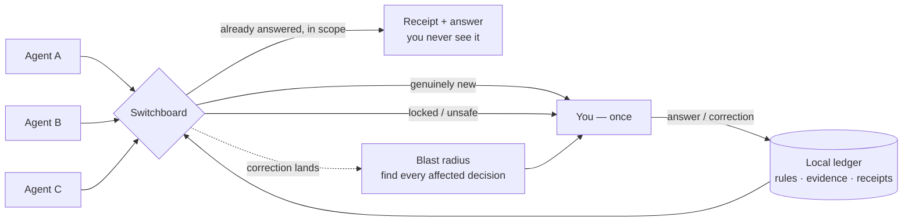
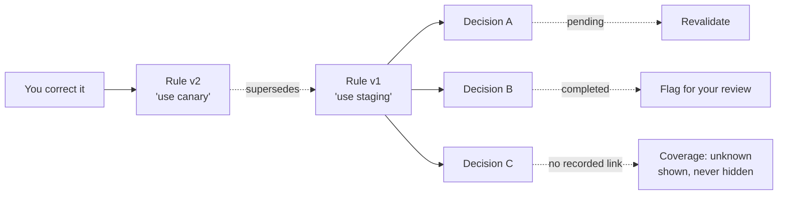
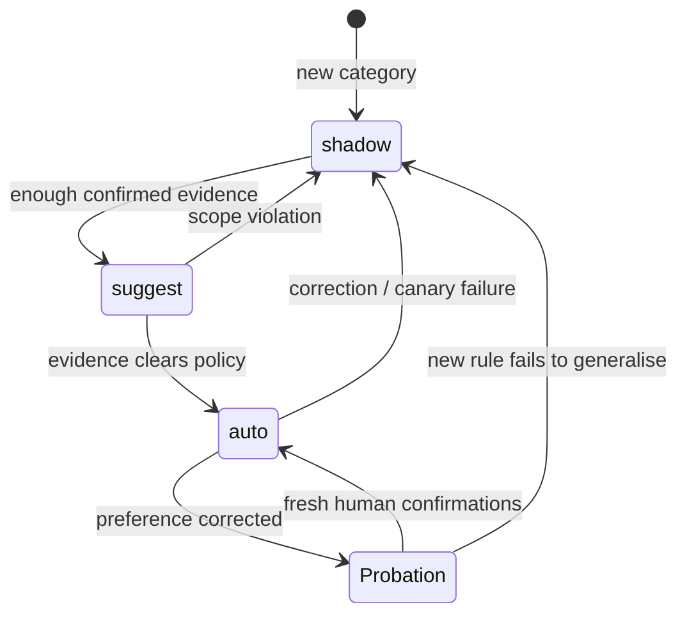
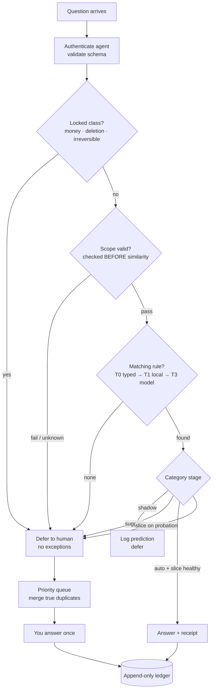
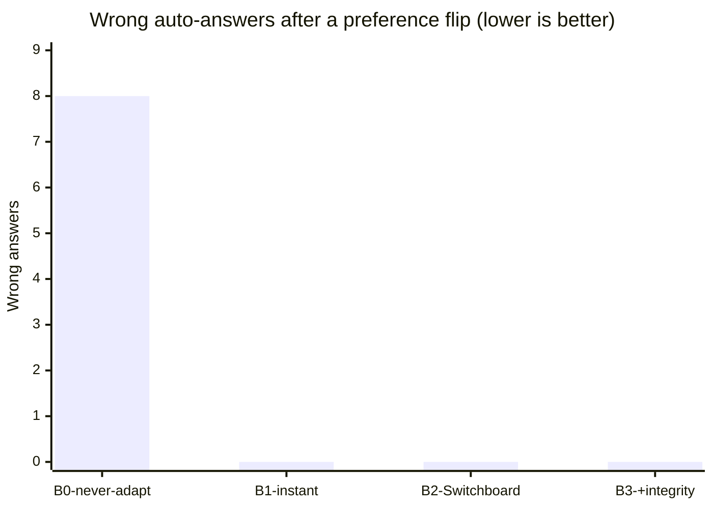
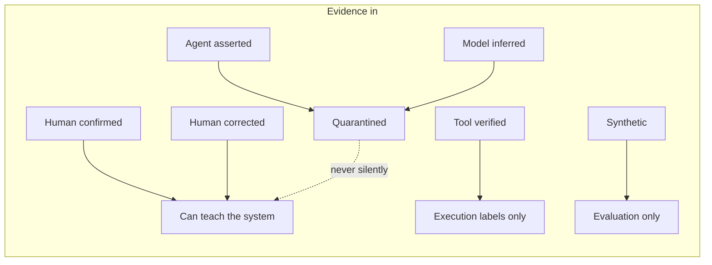

# Switchboard

### Your agents learn when to ask.

Every AI agent you run asks you questions. The same questions. In different words. At the worst possible moments.

One asks which deploy target. Another asks again an hour later. A third applies yesterday's answer to today's completely different situation — confidently, and wrong.

**Switchboard is the layer that fixes this.** It sits between you and your agents, remembers what you actually decided, knows exactly where each decision applies (and where it doesn't), and only interrupts you when interrupting you is genuinely worth it.

> The scarce resource in a multi-agent workflow isn't compute. It isn't context. **It's your attention.**
> Switchboard treats your attention like it matters.

---

## The big picture



Three agents, one brain for preferences, one human interruption budget.

## What it actually does

**Ask less — not blindly less.**
Agents ask Switchboard first. If you've already answered this, in this scope, with a rule that's still current — the agent gets the answer instantly, with a receipt. You never see the question. If not, the question joins a priority queue where truly identical questions are merged into one card. You answer once; every waiting agent gets it.

**Corrections that understand blast radius.**
Change your mind about a preference, and Switchboard doesn't just update a note. It finds *every previous decision that relied on the old rule*, flags the pending ones for revalidation, and shows you the list. No more stale assumptions quietly compounding downstream.



**Preferences that know their boundaries.**
"Use staging" was your answer *for staging*. When an agent tries to reuse it in production just because the words look similar, Switchboard blocks it. Scope is checked *before* similarity — a hard boundary, not a vibe.

**Evidence with a chain of custody.**
An agent claiming "it worked" is not the same as you confirming it, and Switchboard never pretends otherwise. Agent self-reports, model guesses, and synthetic test data are quarantined by design. Only human-confirmed evidence can teach the system anything.

**Autonomy you can read.**
Every category lives in one of three stages — `shadow` (watching), `suggest` (asking), `auto` (acting) — and its Autonomy Passport tells you exactly why, on what evidence, with what limits. When a correction lands, the flipped slice goes back on probation automatically. No silent promotions. No mystery confidence scores.



---

## See it think



A question arrives → Switchboard checks the locks → checks scope → checks memory → answers or defers → issues a receipt. The whole decision is auditable afterwards: which rule, which version, which evidence, which stage allowed it.

And when it can't answer safely? **It defers. Every time.** Locked actions — money, deletions, messages to new recipients, anything irreversible — *always* come to you in v1. No exceptions, no learned overrides, no Away-mode bypass.

---

## The visual side

Switchboard asks questions with pictures, not just text.

- **Visual Scout** takes an image, segments the objects in it with **SAM 3.1**, and asks one focused question about the actual thing you pointed at — click the lamp, and its real pixel mask lights up.
- **Muse Image** generates and edits concept previews as you steer: cheaper ← → more comfort, explore ↑, keep it simple ↓. Four edges, labels written for *this* question, driven by swipe, click, or arrow keys.
- Generated images are always labelled as concepts. Never dressed up as real listing photos. Prices and facts come from real inputs or are marked unknown.

Gestures steer. They never authorize. A swipe can reshape a proposal — it cannot buy, send, or delete anything.

---

## Quickstart

```powershell
uv sync
uv run python -m switchboard.app
```

Open **http://127.0.0.1:8765** in your browser.

Local-first, always: the ledger lives on your machine, model calls are opt-in, and every provider failure results in a deferral — never a guessed answer.

## Connect your agents (MCP)

Register an agent in the UI (**Agents & rules** tab), put its key in the agent's environment, and point it at Switchboard:

```powershell
$env:SWITCHBOARD_AGENT_KEY = "sb_..."
uv run python -m switchboard.mcp_server          # stdio
# or
$env:SWITCHBOARD_MCP_TRANSPORT = "streamable-http"  # http://127.0.0.1:8766/mcp
uv run python -m switchboard.mcp_server
```

MCP tools: `ask`, `get_rules`, `report_outcome`, `record_use`. Agent identity comes from credentials, never from payload JSON. A workspace `.mcp.json` is included for MCP-compatible clients, and a working demo harness lives in `harness/`.

For frontend development:

```powershell
cd frontend
npm install
npm run dev      # http://127.0.0.1:5173, proxies the API to :8765
npm run build    # FastAPI serves the build at /
```

---

## Does it work? Here's the evidence — including where it doesn't.

Our replay harness runs identical synthetic preference-flip traces against four strategies. After a user changes a preference:

| Strategy | Coverage | Wrong auto-answers | Stale answers after the flip |
|---|---|---|---|
| B0 · never adapt | 0.91 | 8 | 8 |
| B1 · adapt instantly | 0.91 | 0 | 0 |
| B2 · Switchboard | **0.73** | **0** | **0** |
| B3 · B2 + evidence integrity | **0.73** | **0** | **0** |

B2 trades some coverage for safety: after a correction, the flipped slice serves a short probation — a handful of confirmations — while everything unrelated keeps flowing. Under a *noisy* first correction (the fix itself is wrong), that probation measurably wins: 2 wrong auto-answers vs B1's 3. Under a *misscoped* correction, both fail — a hold cannot fix a scope the system was never told, and we show that result instead of hiding it.

Adversarial agents flooding fake "it worked" reports? Measured: a naive system that counts agent labels gets contaminated; Switchboard's count stays at zero.





These are synthetic traces, labelled as such, with uncertainty intervals — not a population error guarantee. Anyone who promises you a proven 2% error rate from eleven questions is selling something. We'd rather show the trade-off.

## Test

```powershell
uv run pytest -q
```

40 tests, including a real subprocess MCP-over-HTTP integration test.

---

## Optional model providers

All behind feature flags, all failing safe to a deferral:

| Provider | Role | Model |
|---|---|---|
| Modal | reasoning (T3) | Muse-Spark-Open-816B-A42B (self-hosted endpoint) |
| Baseten | reasoning (T3) | `meta-models/muse-spark-open-1026` |
| Meta Model API | reasoning + SAM 3.1 + Muse Image | `muse-spark-1.3`, `sam-3.1`, `muse-image-1.0` |

Deterministic logic — locks, scope, matching tiers, receipts, authorization — is never delegated to a generative model.

---

*Switchboard doesn't replace your agents. It teaches them the one skill they all lack: knowing when to ask.*
