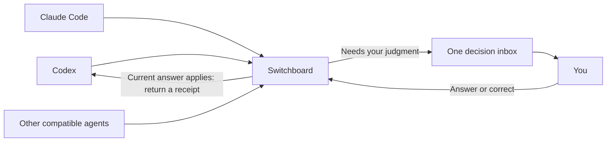
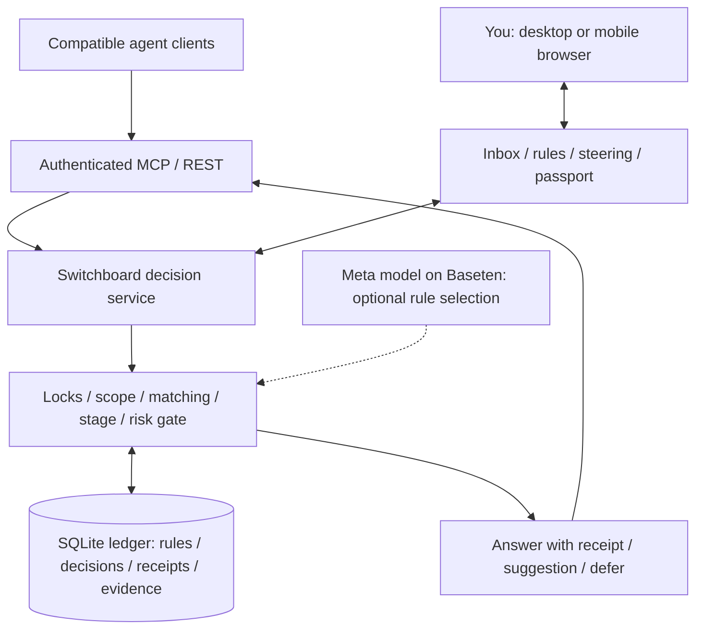

# Switchboard

### One person. Many agents. A shared place for decisions.

Your coding agent asks which environment to use. Your research agent asks about your budget. Your next agent asks the same questions again. Each conversation starts from scratch, while yesterday's answers quietly become today's assumptions.

**Switchboard is your autonomy layer across compatible AI agents.** Agents check it before interrupting you. It returns an existing answer when that answer still applies, brings unresolved questions to one inbox, and tracks what depended on each decision.

The goal is fewer interruptions, with you in control of what agents can reuse.

Built for the **Meta × Cerebral Valley hackathon**, with Meta models through **Baseten** and deployment on **Modal**.

## Answer once. Keep the boundaries.

Imagine you tell Claude Code: “Use staging for this project.”

1. **A second agent asks.** Codex can reuse that answer when the project, environment, and category policy permit it. It gets a receipt explaining which rule applied.
2. **The context changes.** A production request cannot inherit the staging answer just because its wording is similar. Missing required context also prevents reuse.
3. **You change your mind.** Switchboard versions the rule, shows the decisions that used it, and flags affected pending work for revalidation. The changed rule enters a recalibration hold; unrelated rules can keep working.
4. **An agent says “it worked.”** That report is recorded as an agent claim. It cannot stand in for your confirmation or earn the system more autonomy.

That is the product's promise: **a decision can travel between agents without losing its scope, history, or owner.**



## What you get

| Capability | What it means in daily use |
|---|---|
| **A shared inbox** | Compatible unresolved questions can be grouped so several waiting agents receive one human answer. |
| **Scoped rules** | Project, environment, intent, and other required context determine where an answer applies. |
| **Decision receipts** | See why an answer was returned, the rule version behind it, and recorded downstream uses. |
| **Corrections with impact tracking** | See which earlier decisions relied on a superseded rule and which work needs another look. |
| **Visible autonomy** | An Autonomy Passport shows each category's stage, evidence, holds, and limits. |
| **Proposal steering** | Ask for a cheaper, simpler, or different direction without treating that gesture as authorization. |

The intended impact is fewer repeated interruptions, fewer stale assumptions, and corrections you can follow through the work. Those outcomes are what the evaluation measures; they are not assumed from tool connectivity alone.

## How a decision earns an answer

Switchboard checks hard locks and mandatory scope before matching an existing rule. It then applies the category's stage, recalibration holds, and configured risk gate.

- **`shadow`** records what the system would have answered and queues the question.
- **`suggest`** proposes an answer for human review.
- **`warn`** returns an answer with a notice the user can review or veto.
- **`auto`** returns an eligible answer without another interruption.

New categories start in `shadow`. Stages are configured; the system does not silently promote itself. The evidence-based risk gate defaults to observation mode (`SWITCHBOARD_RISK_GATE_MODE=shadow`); `enforce` makes insufficient evidence a reason to defer. Hard locks and mandatory scope checks apply independently of that setting.

Payments, deletions, messages to new recipients, and actions classified as irreversible are locked for automatic answering. A model, a learned preference, or an Away-mode grant cannot remove those locks.

When Switchboard defers, the agent leaves the question in its inbox and continues independent work. It must not guess, repeat the question directly to the user, or treat a queued request as permission.

## Architecture

MCP and REST enter the same decision service. The web interface is where you answer, correct, steer, and inspect the results.



**The application owns authorization.** Exact rules and local similarity matching work without model calls. Optional Meta reasoning can select an existing eligible rule; it cannot invent an active rule, lower risk, or authorize an action. Model confidence is not treated as a calibrated probability.

Each decision retains a versioned policy trace. Dependency records connect receipts to downstream work. Human confirmations and corrections can contribute to calibration; agent claims, model inferences, tool events, and synthetic traces do not count as human preference labels.

The backend is Python/FastAPI, the interface is React/TypeScript, and MCP connects the clients. A local installation keeps its ledger on the machine. Hub mode sends authenticated agent requests to one shared deployment. The current Modal hub uses a persistent volume and a single SQLite writer.

### Where Meta, Baseten, and Modal fit

| Component | Role |
|---|---|
| **Meta model through Baseten** | Optional reasoning and semantic rule selection, using the configured Muse Spark Open model endpoint. |
| **Modal** | Hosts the Switchboard hub, persistent ledger, and configured model endpoints. The backend also supports Modal reasoning adapters. |
| **SAM 3.1 / Muse Image** | Optional image grounding and concept previews through configured provider endpoints. |

Visual Scout can ground a question in an object selected from an image. Concept previews let you explore a proposal's direction. Generated concepts are labelled; unknown prices or facts remain unknown. **Steering changes a draft. It does not buy, send, or delete.**

## Agent support today

The November 2026 integration pass tested actual MCP calls and authenticated identities, including launches from an unrelated working directory.

| Client | Verified connection | Automatic Switchboard action gate |
|---|---|---|
| Codex desktop / CLI | Global and project configuration; authenticated MCP calls | Ask-first instructions; no pre-tool gate verified |
| Claude Code / extension | Native CLI connection and authenticated MCP calls | Project hook, including failure blocking |
| OpenCode | Native CLI connection and authenticated MCP calls | Project plugin; broken credentials keep actions blocked |
| Muse Code | Authenticated calls from the saved user configuration | Ask-first instructions |
| Claude Desktop | Authenticated calls from both Windows configuration locations | Ask-first instructions |
| Hermes | Native Windows installation, native MCP discovery, authenticated calls | Ask-first instructions |
| Claude / ChatGPT mobile | Hosted OAuth discovery, PKCE, MCP calls, refresh, and revocation | **Account/device linking remains pending** |

MCP gives an agent access to Switchboard. Enforcing every tool call requires a harness-specific gate. The installed Claude Code and OpenCode gates apply in this project; other clients must follow their instructions. Existing sessions need an MCP reload or restart after configuration changes.

See the [client support report](integrations/CLIENT_SUPPORT.md), [Claude Code gate](integrations/CLAUDE_CODE_ACTION_GATE.md), [OpenCode gate](integrations/OPENCODE_ACTION_GATE.md), and [mobile connector setup](integrations/CLAUDE_MOBILE.md).

## Run locally

Requires Python 3.12+, [uv](https://docs.astral.sh/uv/), and Node.js/npm for the React interface.

```powershell
uv sync
npm --prefix frontend ci
npm --prefix frontend run build
uv run python -m switchboard.app
```

Open **http://127.0.0.1:8765**. A fresh checkout runs without model credentials. Optional features and provider settings are documented in [.env.example](.env.example).

To use Meta reasoning through Baseten, keep `BASETEN_API_KEY` in your private `.env`, select `SWITCHBOARD_REASONING_PROVIDER=baseten`, and enable `SWITCHBOARD_ENABLE_T3=true`. The example configuration also supports Modal and Meta API adapters. Model calls are opt-in; an unavailable provider cannot supply an automatic answer.

For frontend development, run `npm --prefix frontend run dev` alongside the backend. Vite serves port **5173** and proxies API requests to **8765**.

### Connect a client

Register a dedicated agent in **Agents & rules**. Save its one-time key in a private file, then generate the client's configuration:

```powershell
uv run python -m switchboard.onboard --agent codex --api-key-file C:/private/codex.key
```

Merge the generated entry into the client's existing settings. Other supported names include `claude-code`, `opencode`, `muse`, `claude-desktop`, and `hermes`. Add `--remote https://your-hub.example` to share a hosted ledger. Generated files go to ignored `integrations/generated/`; never commit real credentials.

Start verification with **`get_connection_status`** and check the expected agent identity, then call **`get_rules`**. Discovering tools alone does not establish a working connection. Failed hub lookups return an explicit error rather than an apparently empty rule set.

The nine MCP tools cover three workflows:

| Workflow | Tools |
|---|---|
| Decide | `ask`, `get_rules`, `get_action_request_status` |
| Verify and account for use | `get_connection_status`, `record_use`, `report_outcome` |
| Steer a proposal | `submit_proposal`, `get_steering`, `revise_proposal` |

Agents should ask with a stable request ID, honor the returned scope, record receipt use before dependent work, and report outcomes as agent assertions. Agent identity comes from credentials, never a name supplied in a request. See [AGENTS.md](AGENTS.md) for the protocol and [the external harness](harness/external_harness.py) for an MCP example.

### Use it from your phone

The **Switchboard web interface** works on mobile screens. For a local instance, the [tunnel script](scripts/start-tunnel.ps1) creates an authenticated login link:

```powershell
powershell -ExecutionPolicy Bypass -File scripts/start-tunnel.ps1
```

Treat that link like a password; it grants operator access and sets a 30-day cookie. A token-protected hosted hub also serves the interface directly.

Connecting **Claude or ChatGPT's mobile app** is a separate account-level OAuth step. The server flow is tested; installation in the user's accounts and phones is still pending. See [mobile setup](integrations/CLAUDE_MOBILE.md).

### Deploy on Modal

Configure the existing Modal profile, `switchboard-secrets`, and the public HTTPS origin for OAuth. Build the frontend and back up the persistent ledger before deployment:

```powershell
$env:SWITCHBOARD_MCP_PUBLIC_URL = "https://your-modal-function-host"
$env:SWITCHBOARD_BUILD_ID = "your-git-commit"
modal deploy --strategy recreate modal_app.py
```

The hosted MCP endpoint is `<public-origin>/mcp`. OAuth and operator routes have separate authentication. Keep one container while using the SQLite volume; `recreate` avoids overlapping writers and delayed rolling replacements. See [modal_app.py](modal_app.py) and the [deployment notes](integrations/CLIENT_SUPPORT.md#enforcement-and-deployment).

## Evidence and limits

The integration pass verified **173 backend tests**, the frontend production build, authenticated client calls, mobile OAuth flows, and seven OpenCode gate scenarios. These establish tested behavior, not universal compliance by every agent or a connection to every user's phone.

The [replay evaluator](switchboard/evaluation.py) compares the same **synthetic** preference-change traces:

| Strategy | Answered automatically | Wrong automatic answers | Stale answers after a correction |
|---|---:|---:|---:|
| Ignore the correction (B0) | 91% | 8 | 8 |
| Apply it and immediately resume (B1) | 91% | 0 | 0 |
| Switchboard with recalibration holds (B2) | 73% | 0 | 0 |
| B2 with evidence-integrity checks (B3) | 73% | 0 | 0 |

The simple trace favors immediate reuse. The harder question is what happens when the correction itself is wrong: in the noisy-correction trace, recalibration gives **0 wrong automatic answers versus B1's 3**, at **43% versus 100% coverage**. More review buys an opportunity to catch the mistake. When the supplied scope is wrong, both can fail; a hold cannot recover a boundary the system was never told.

These are small, correlated synthetic traces, not real-user results or a production error-rate guarantee. B3's difference is evidence eligibility; it does not change the simple trace's answers. Adaptive policy proposals, automatic promotion, and AI rewriting of active autonomy policies remain future work.

### Verification

```powershell
uv run pytest -q
node tests/test_opencode_gate.mjs
```

Set `SWITCHBOARD_IT=1` to include the real subprocess MCP-over-HTTP test. Backend coverage includes policy, scope, corrections, evidence integrity, migrations, cache behavior, authentication, OAuth, and portable client configuration.
